<p align="center"></p>

<p align="center"><a href="https://logbookfordevs.com">logbookfordevs.com</a> &nbsp;·&nbsp; <a href="https://logbookfordevs.substack.com/">Substack</a> &nbsp;·&nbsp; <a href="https://www.linkedin.com/in/leonardord99">LinkedIn</a> &nbsp;·&nbsp; <a href="https://x.com/leo_kumo">@leo_kumo</a> &nbsp;·&nbsp; <a href="https://medium.com/@leonardord99">Medium</a> &nbsp;·&nbsp; <a href="https://www.instagram.com/logbookfordevs/">Instagram</a></p>

## 🗺️ Quest log

<p align="center"><a href="https://logbookfordevs.com"></a><a href="https://github.com/logbookfordevs/yggdrasil-worktree"></a><a href="https://github.com/logbookfordevs/react-currency-mask"></a><a href="https://github.com/logbookfordevs/atlas-skills"></a><a href="https://github.com/logbookfordevs/ai-field-kit"></a></p>

Most of what I'm building lives in the **[LogBook for Devs organization](https://github.com/logbookfordevs)**. I'd rather keep things evolving in one place than maintain a static list here.

## 🧙 Character sheet

```ts
const leo = {
  role: "Software Engineer → Frontend / AI Engineer",

  currentFocus: [
    "AI-assisted dev workflows",
    "Human-in-the-loop systems",
    "Internal tooling & DX",
    "Frontend as product surface"
  ],

  howIWork: [
    "Spec → RFC (optional) → Implementation",
    "Clarity over cleverness",
    "Systems > isolated features",
    "Clarity, maintainability, performance and strategy are trade-offs, not afterthoughts",
    "Ship, learn, refine"
  ]
};
```

**Lately I've been** structuring things before coding, working with AI (flows, orchestration, usage patterns), thinking about how things feel to use, and building tools that help me (and others) move faster.

**In interfaces, I care about** motion as communication, experiences that guide you the way games, anime and cinematics do, and micro-interactions that add clarity and a bit of joy.

**My AI party:** Codex, Claude and OpenCode, plus custom workflows and orchestration (multi-step flows, tools, feedback loops).

## 🎒 Inventory

<p align="center"></p>

<p align="center"></p>
